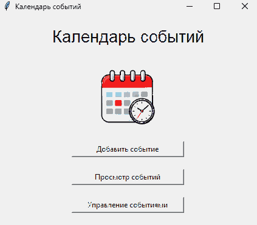

# Календарь событий

Небольшой календарь на Python с графическим интерфейсом. События сохраняются в SQLite, поэтому не пропадают после закрытия программы.

## Что умеет

- Добавлять события по названию и дате.
- Показывать события за выбранный месяц.
- Считать, сколько дней осталось до события или прошло после него.
- Редактировать и удалять записи.
- Проверять даты: например, 31.02.2026 не примет.

## Запуск

Нужен Python 3 с Tkinter. Скачайте репозиторий и выполните в его папке:

**Windows:**
```bash
python main.py
```

**macOS:**
```bash
python3 main.py
```

Откроется окно с кнопками добавления, просмотра и управления событиями. Для хранения используется файл `events.db`; если его нет, программа создаст новую базу. Устанавливать дополнительные библиотеки не нужно.

## Скриншоты

**Главное окно**



**Просмотр событий**


## Проверка

Для работы с датами есть 6 модульных тестов: корректная дата, несуществующая дата, неверный формат, прошедшее событие, будущее событие и сегодняшняя дата.

**Windows:**
```bash
python -m unittest discover -s tests -v
```

**macOS:**
```bash
python3 -m unittest discover -s tests -v
```

Тесты также запускаются через GitHub Actions после обновления репозитория.

## Файлы проекта

- `main.py` — интерфейс и работа с SQLite.
- `calendar_utils.py` — проверка дат и расчёт дней.
- `tests/test_calendar_utils.py` — модульные тесты.
- `logo.gif` — изображение в главном окне.
