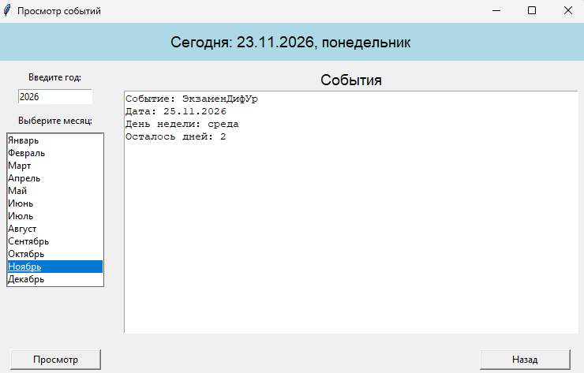

# Календарь событий

Небольшое приложение на Python для хранения событий и просмотра их по датам. Можно добавить событие, найти его по месяцу, изменить или удалить. Календарь показывает, сколько дней осталось до события или сколько прошло после него.

В приложении есть управление сохранёнными событиями и отдельные тесты для проверки обработки дат.

## Что умеет

- Добавлять события с названием и датой.
- Проверять введённые даты: например, 31 февраля не сохранится.
- Показывать события за выбранные год и месяц.
- Считать дни до события и после него.
- Редактировать название и дату сохранённого события.
- Удалять события после подтверждения.
- Сохранять данные в SQLite между запусками.

## Технологии

Python 3, Tkinter (окна приложения), SQLite (хранение событий), unittest (проверка логики дат). Внешних Python-пакетов проект не требует.

## Как запустить

Нужен Python 3 с работающим Tkinter. Скачайте репозиторий, распакуйте его и откройте папку проекта в терминале.

**macOS:**
```bash
python3 main.py
```

**Windows:**
```powershell
python main.py
```

После запуска откроется окно с тремя кнопками: «Добавить событие», «Просмотр событий» и «Управление событиями». Файл `events.db` используется для хранения событий. Если его нет, программа создаст новую базу при первом запуске.

Если окно не открывается, проверьте наличие Tkinter командой `python3 -m tkinter` на macOS или `python -m tkinter` на Windows. В некоторых установках Python Tkinter нужно подключить отдельно.

## Скриншоты

**Главное окно**


**Просмотр сохранённых событий**



## Пример работы

Допустим, пользователь добавляет событие «Экзамен» на 25.12.2026.

После сохранения программа показывает:
```text
Событие добавлено!
```

В разделе просмотра оно отображается примерно так (количество дней зависит от текущей даты):
```text
Событие: Экзамен
Дата: 25.12.2026
День недели: пятница
Осталось дней: ...
```

При вводе несуществующей даты, например 31.02.2026, программа выводит `Неверная дата` и не сохраняет событие. Через раздел «Управление событиями» можно выбрать запись, изменить поля или удалить её с подтверждением.

## Как проверить

Для проверки обработки дат есть шесть модульных тестов: правильная дата, неправильная дата, неверный формат, событие в будущем, в прошлом и сегодня.

Из папки проекта запустите:

**macOS:**
```bash
python3 -m unittest discover -s tests -v
```

**Windows:**
```powershell
python -m unittest discover -s tests -v
```

Для этих проверок не нужно открывать интерфейс или создавать настоящие события.

## Структура проекта

- `main.py` — окна приложения, действия пользователя и запросы к базе.
- `calendar_utils.py` — проверка дат и расчёт количества дней.
- `tests/test_calendar_utils.py` — модульные тесты.
- `events.db` — SQLite-база с событиями.
- `logo.gif` — изображение в главном окне.

В проекте нет необходимости устанавливать зависимости через `pip`: используются стандартные модули Python. Проверка графического интерфейса вручную и модульные тесты — отдельные способы проверки работы приложения.
